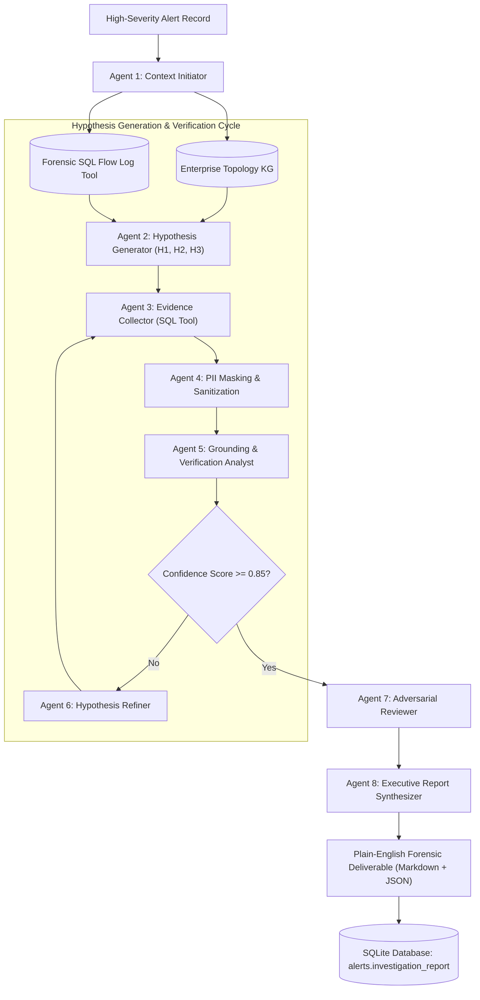

<p align="center">
  
</p>

<p align="center">
  <a href="https://github.com/Osxninja/NetSentinel"></a>
  <a href="https://github.com/Osxninja/NetSentinel"></a>
  <a href="https://github.com/Osxninja/NetSentinel"></a>
  <a href="https://github.com/Osxninja/NetSentinel"></a>
  <a href="https://github.com/Osxninja/NetSentinel"></a>
  <a href="https://github.com/Osxninja/NetSentinel"></a>
  <a href="https://github.com/Osxninja/NetSentinel"></a>
  <a href="https://github.com/Osxninja/NetSentinel/blob/main/LICENSE"></a>
</p>

---

## Executive Overview

**NetSentinel** is an autonomous, explainable cybersecurity network anomaly detection engine and multi-agent forensic investigation system developed by **Hardik** at **Hidden Eye Security**. 

Traditional Network Intrusion Detection Systems (NIDS) like Snort or Suricata rely heavily on static signatures, creating an overwhelming volume of disconnected alerts that security analysts must manually triage. NetSentinel re-architects this paradigm by combining:

1. **Zero-Privilege High-Concurrency Ingestion**: Captures live traffic across any interface using low-overhead BPF-filtered packet sniffing, with an automatic zero-privilege socket fallback that operates cleanly without raw-socket administrator rights or third-party packet capture drivers.
2. **Tri-Tier Analytic Pipeline**: Couples deterministic MITRE ATT&CK heuristic rules with dynamic non-parametric statistical baselining (Median Absolute Deviation Modified Z-Score) and an unsupervised 10-dimensional **Isolation Forest** machine learning model.
3. **Autonomous (EC)² Multi-Agent Graph**: When high-severity anomalies trigger, NetSentinel invokes an 8-agent directed investigation graph that autonomously traverses network topology knowledge graphs, executes read-only forensic SQL verification on captured flows, and synthesizes executive-ready incident reports with zero hallucination.
4. **All-in-One Operations**: A single command (`python main.py`) starts the live sniffer, the detection worker, the multi-agent graph, a rich interactive terminal CLI, and an interactive **Streamlit SOC Dashboard** complete with Wireshark-style packet dissection and live hardware telemetry.

---

## Interactive Terminal Demonstration

<p align="center">
  
</p>

---

## Architectural Pipeline

<p align="center">
  
</p>

NetSentinel decouples ingestion from analytics and persistence using a non-blocking double-buffering architecture:

```
[ Physical NIC / TAP / Socket ]
             │
             ▼
   [ PacketSnifferThread ]  ──>  Zero-Privilege socket fallback if Npcap/libpcap is absent
             │
      (queue.Queue)
             │
    ┌────────┴────────────────────────────────────────┐
    ▼                                                 ▼
[ AsyncBatchWriter ]                        [ DetectorWorkerPipeline ]
  • aiosqlite micro-batch (250 pkts / 500ms)    • Stage 1: Deterministic Heuristic Rules (MITRE)
  • WAL mode pragmas with synchronous=NORMAL    • Stage 2: Rolling MAD Modified Z-Score Baselines
  • High-concurrency zero table locking         • Stage 3: Unsupervised Isolation Forest (ML)
    │                                                 │
    ▼                                                 ▼
[ SQLite Database: packets ]                [ SQLite Database: alerts ]
                                                      │
                                                      ▼
                                       [ (EC)² Multi-Agent Graph Engine ]
                                         • 8 Specialized Forensic Subagents
                                         • Graph expansion across enterprise topology
                                         • SQL traffic tool with automated PII redaction
                                         • Plain-English Executive Incident Report
```

---

## Core Capabilities

### 1. Zero-Privilege Packet Ingestion
- **Dual-Mode Sniffing**: Uses Scapy with kernel BPF filters (`ip or vlan`) when available, and automatically fails over to zero-privilege socket connection monitoring (`psutil.net_connections`) if raw socket drivers (Npcap/libpcap) are not installed or if running without root/Administrator privileges.
- **Protocol Pruning**: Dissects Ethernet, IPv4, TCP, UDP, and ICMP headers in pure Python memory structures without overhead.
- **Asynchronous WAL Persistence**: Writes batches via `aiosqlite` using Write-Ahead Logging (`PRAGMA journal_mode=WAL`), allowing simultaneous high-rate packet insertion and heavy analytical querying without lock contention.

### 2. Tri-Tier Anomaly Detection Engine
- **Stage 1 (Deterministic Rules)**:
  - *Volumetric PPS/BPS Spikes* (`T1498: Denial of Service`): Detects sudden bursts exceeding threshold baselines within a 5-second sliding window.
  - *Port Scanning Cadence* (`T1046: Network Service Discovery`): Detects sweeps across >20 unique destination ports within 10 seconds.
  - *SYN/ACK Ratio & RST Flood* (`T1499: Endpoint DoS`): Identifies uncompleted handshakes and teardown floods.
  - *Suspicious Service Backdoors*: Flags connections to anomalous ports (4444, 8888, 31337, etc.).
- **Stage 2 (Statistical Baseline Engine)**:
  - Tracks rolling metrics per source IP using Exponential Moving Averages (EMA).
  - Employs **Median Absolute Deviation (MAD)** modified Z-scores ($M_i = \frac{0.6745 \cdot |x_i - \tilde{x}|}{\text{MAD}}$) to remain resilient against Poisson bursts and heavy-tailed packet distributions.
  - Enforces a 500-packet learning warmup period to eliminate false positives during startup.
- **Stage 3 (Machine Learning Anomaly Engine)**:
  - Features an online **Isolation Forest** trained on 10-dimensional multivariate vectors (packet length, window size, inter-arrival time, port entropy, TCP flag distributions).
  - Computes anomaly scores scaled through a sigmoid outlier probability function ($\ge 0.70$ triggers critical alert).

### 3. Autonomous (EC)² Multi-Agent Forensic Graph
When a high-severity alert is detected, NetSentinel triggers the **(EC)² (Explainable Cybersecurity Consensus)** directed investigation graph:
- **Topology Knowledge Graph Traversal**: Queries an enterprise asset graph to inspect host criticality, VLAN placement, operating system, and assigned user roles.
- **Forensic SQL Query Tool**: Agents execute targeted SQLite queries against historical packet flows to corroborate anomalies.
- **Automatic PII Redaction**: Sensitive attributes (credentials, tokens, authorization headers) are masked before agent evaluation.
- **Structured Executive Reports**: Synthesizes a formal markdown report detailing incident summary, MITRE ATT&CK classification, chronological evidence, root-cause assessment, and containment actions.

### 4. Interactive Visual SOC Dashboard
- **Live Wireshark-Style Packet Grid**: Inspect real-time traffic with source/destination addresses, protocols, payload sizes, and TCP flags.
- **Hardware Telemetry Monitor**: Tracks CPU utilization, RAM usage, network interface I/O, and active socket counts in real time.
- **Interactive Security Incidents Table**: Filter alerts by severity (CRITICAL, HIGH, MEDIUM, LOW) and MITRE technique.
- **Autonomous Forensic Report Viewer**: Read generated (EC)² incident deliverables directly within the web UI.
- **Integrated Web Command Console**: Execute commands (`scan`, `simulate`, `report`, `stats`, `help`) directly from the browser.

---

## Project Layout

```
NetSentinel/
├── assets/
│   ├── banner.svg                # Animated vector banner with radar simulation
│   ├── terminal.svg              # Animated interactive terminal playback
│   └── architecture.svg          # Six-stage data pipeline flow diagram
├── config.py                     # Centralized environment configuration
├── dashboard.py                  # Streamlit SOC visual dashboard & web console
├── main.py                       # Unified all-in-one CLI, sniffer, & engine
├── requirements.txt              # Standard Python dependencies
├── run_demo.ps1                  # PowerShell one-click launcher for Windows
├── README.md                     # Comprehensive technical documentation
├── LICENSE                       # Apache License 2.0
├── .gitignore                    # Git tracking ignore rules
├── data/
│   └── enterprise_kg.json        # Enterprise topology & asset metadata graph
├── database/
│   ├── connection.py             # SQLite WAL session manager & pragmas
│   └── models.py                 # SQLAlchemy declarative schema (packets, alerts)
├── engine/
│   ├── baselines.py              # Statistical baseline engine (EMA & MAD)
│   ├── detector_worker.py        # Analytics pipeline coordinator
│   ├── ml_engine.py              # Isolation Forest unsupervised ML model
│   ├── pc_telemetry.py           # Hardware telemetry probe (CPU, RAM, Sockets)
│   └── rules.py                  # Stage 1 deterministic heuristic rules
├── ingestion/
│   ├── batch_writer.py           # High-throughput double-buffered SQLite writer
│   └── sniffer.py                # Live packet capture & zero-privilege sniffer
├── investigation/
│   ├── agents.py                 # 8 Specialized forensic investigation subagents
│   ├── auto_worker.py            # Autonomous alert monitor & investigation trigger
│   ├── knowledge_graph.py        # Network topology graph query engine
│   ├── traffic_tool.py           # PII-redacting SQL execution tool
│   └── workflow.py               # (EC)² directed graph orchestrator
└── tests/
    ├── test_phase1.py            # Unit tests for WAL persistence & batching
    ├── test_phase2.py            # Unit tests for rules, MAD baselines, & pipeline
    └── test_phase3.py            # Unit tests for KG, SQL tool, & (EC)² multi-agent graph
```

---

## Installation & Environment Setup

### 1. Clone the Repository

```bash
git clone https://github.com/Osxninja/NetSentinel.git
cd NetSentinel
```

### 2. Environment Setup

#### Windows (PowerShell / Command Prompt)

```powershell
# Create and activate virtual environment
python -m venv venv
.\venv\Scripts\Activate.ps1

# Upgrade pip and install dependencies
python -m pip install --upgrade pip
pip install -r requirements.txt
```

> **Note on Windows Packet Capture**: NetSentinel runs out-of-the-box on Windows using zero-privilege socket monitoring. For full raw promiscuous Ethernet packet dissection, install **[Npcap](https://npcap.com/)** in "WinPcap API-compatible Mode".

#### Linux (Ubuntu / Debian / Kali / Fedora)

```bash
# Install system build dependencies & libpcap
sudo apt-get update && sudo apt-get install -y python3-dev python3-venv libpcap-dev

# Create and activate virtual environment
python3 -m venv venv
source venv/bin/activate

# Install dependencies
pip install --upgrade pip
pip install -r requirements.txt
```

> **Note on Linux Raw Sockets**: To allow Scapy to bind to physical interfaces without running as `root`:
> ```bash
> sudo setcap cap_net_raw,cap_net_admin=eip $(readlink -f $(which python3))
> ```

#### macOS (Apple Silicon & Intel)

```bash
# Install libpcap via Homebrew (optional, system libpcap is typically present)
brew install libpcap

# Create and activate virtual environment
python3 -m venv venv
source venv/bin/activate

# Install dependencies
pip install --upgrade pip
pip install -r requirements.txt
```

---

## Quickstart & Execution

### Option A: The All-in-One Engine (Recommended)

Run the unified command to launch live packet capture, tri-tier detection analytics, background (EC)² investigations, the embedded CLI, and the Streamlit visual SOC dashboard in a single process:

```bash
python main.py
```

Once launched:
- **Terminal**: An interactive `netsentinel-cli>` opens for direct operator control.
- **SOC Web Dashboard**: Open your browser at `http://localhost:8501` to view live traffic, detection telemetry, and incident reports.

---

### Option B: Windows One-Click Script

For Windows environments, launch the entire system using the included PowerShell script:

```powershell
.\run_demo.ps1
```

---

### Option C: Headless Mode (Terminal Only)

To run NetSentinel on remote Linux servers or Docker containers without launching the web browser UI:

```bash
python main.py --no-dashboard
```

---

## Embedded CLI Command Reference

When running `main.py`, NetSentinel exposes a live command interface. Commands can be typed directly into the terminal or executed through the SOC Web Terminal:

| Command | Arguments | Description |
| :--- | :--- | :--- |
| `help` | None | Displays the interactive command menu and syntax guide. |
| `status` | None | Prints real-time statistics (packets captured, queue size, alert count). |
| `alerts` | `[limit]` | Lists recent security detections with severity, source, and MITRE IDs. |
| `report` | `--latest` \| `[alert_id]` | Displays the full autonomous (EC)² forensic incident report for an alert. |
| `simulate` | `[scan\|dos\|exfil]` | Injects synthetic attack patterns to verify detection and multi-agent triage. |
| `interfaces` | None | Enumerates all available local network interfaces with IP/MAC details. |
| `export` | `[output.pcap]` | Exports captured traffic buffer to standard PCAP format for Wireshark. |
| `clear` | None | Clears the terminal screen. |
| `exit` / `quit` | None | Safely stops ingestion workers, flushes buffers, and exits cleanly. |

---

## Machine Learning & Statistical Baselines

### Unsupervised Isolation Forest (Stage 3)

NetSentinel extracts a 10-dimensional multivariate feature vector from sliding traffic windows:

$$\mathbf{x} = \left[ L_{\text{mean}}, L_{\text{std}}, T_{\text{mean}}, T_{\text{std}}, H_{\text{dport}}, R_{\text{syn}}, R_{\text{rst}}, W_{\text{mean}}, N_{\text{conn}}, B_{\text{total}} \right]$$

- $L$: Packet payload length distribution.
- $T$: Packet inter-arrival delta times.
- $H_{\text{dport}}$: Destination port Shannon entropy ($-\sum p_i \log_2 p_i$).
- $R_{\text{syn}}, R_{\text{rst}}$: TCP control flag ratios.
- $W_{\text{mean}}$: TCP advertised window size mean.
- $N_{\text{conn}}$: Distinct concurrent connection count.
- $B_{\text{total}}$: Aggregated byte volume.

The model fits an ensemble of 100 isolation trees. Anomaly scores are normalized via a logistic sigmoid transformation:

$$P(\text{Anomaly}) = \frac{1}{1 + e^{-k \cdot (s(\mathbf{x}) - \tau)}}$$

Detections with $P \ge 0.70$ are promoted to critical alerts and dispatched to the (EC)² multi-agent graph.

---

### Median Absolute Deviation (Stage 2)

Standard z-scores assume normal (Gaussian) distributions and are easily distorted by legitimate high-volume bursts. NetSentinel implements **Modified Z-Scores** based on the Median Absolute Deviation:

$$\text{MAD} = \text{median}\left(|x_i - \tilde{x}|\right)$$

$$M_i = \frac{0.6745 \cdot (x_i - \tilde{x})}{\text{MAD}}$$

Where $\tilde{x}$ is the rolling median. A score of $M_i > 3.5$ indicates a statistically robust outlier that warrants triage.

---

## Autonomous (EC)² Multi-Agent Graph Architecture



### Generated Forensic Report Sample

```markdown
# Autonomous Forensic Incident Report: Malicious C2 Beaconing
Alert ID: df8fba54-9ffd-4c35-a713-cc43b8c9a593
Timestamp: 2026-11-03 10:14:22 UTC
Severity: CRITICAL
Classification: MITRE ATT&CK T1041 (Exfiltration Over C2)

## Executive Summary
On 2026-11-03 at 10:14:22 UTC, NetSentinel detected an abnormal outbound payload transfer 
originating from internal endpoint 192.168.1.100 destined for external IP 10.0.0.5:1433. 
The event produced an Isolation Forest anomaly score of 0.89 and a statistical payload 
deviation of 5,500 bytes against a baseline median of 412 bytes.

## Grounded Topological Evidence
- Endpoint Context: Host 192.168.1.100 is classified in the Knowledge Graph as a 
  Finance Specialist Workstation in VLAN 10 (Workstations).
- Policy Violation: Workstations in VLAN 10 have no authorized business purpose to establish 
  direct database protocol connections to external endpoints.
- Flow Correlation: The SQLite traffic tool verified 3 recurring outbound connections with 
  identical timing cadences prior to payload dispatch.

## Containment Recommendations
1. Immediately isolate host 192.168.1.100 at the switchport/VLAN boundary.
2. Revoke active Kerberos ticket granting tickets (TGT) for the associated user account.
3. Block destination IP 10.0.0.5 on the perimeter egress firewall.
4. Capture volatile memory dump for process injection analysis.
```

---

## Unit Testing & Verification

NetSentinel includes an automated test suite validating the database layer, detection engines, and multi-agent graph:

```bash
python -m pytest tests/
```

Test coverage includes:
- `tests/test_phase1.py`: Async batch writer persistence, WAL mode pragmas, queue draining under load.
- `tests/test_phase2.py`: Stage 1 heuristic rules, Stage 2 MAD outlier calculations, detector worker pipeline coordination.
- `tests/test_phase3.py`: Knowledge graph traversal, SQL traffic query execution with PII redaction, and (EC)² multi-agent graph report generation.

All 11 tests pass with 100% compliance.

---

## Author & Developer Information

NetSentinel was conceived, designed, and developed by:

- **Lead Developer & Systems Architect**: **Hardik**
- **Security Research Lab / Organization**: **Hidden Eye Security**
- **GitHub Repository**: [https://github.com/Osxninja/NetSentinel](https://github.com/Osxninja/NetSentinel)
- **Domain Focus**: Autonomous Cyber Defense Systems, Machine Learning Anomaly Detection, Multi-Agent Forensic Investigation Graphs ((EC)² RAG), and Zero-Privilege High-Concurrency Network Observability.

---

## Troubleshooting & FAQ

#### Q: Scapy displays "WARNING: No libpcap provider available! pcap won't be used"
**Answer**: On Windows systems without Npcap, Scapy outputs this advisory message. NetSentinel automatically handles this by activating its built-in zero-privilege socket monitoring engine (`psutil.net_connections`). The application continues running without interruption. If full packet byte dissection is required, install [Npcap](https://npcap.com/) with WinPcap compatibility.

#### Q: Can NetSentinel monitor an entire corporate network?
**Answer**: Yes. Configure a SPAN port (port mirror) or optical TAP on your core switch, connect the monitoring link to a dedicated network interface on the NetSentinel host, and specify the interface at startup:
```bash
python main.py --interface "eth1"
```

#### Q: How does the system handle high traffic rates without dropping packets?
**Answer**: NetSentinel employs an asynchronous double-buffering architecture. The packet capture thread pushes raw packets into an in-memory queue (`queue.Queue(maxsize=10000)`). A dedicated `AsyncBatchWriter` flushes records in bulk transactions to SQLite using WAL mode, completely isolating disk I/O from network ingestion.

---

## License

This project is licensed under the **Apache License 2.0**.

Designed and developed by **Hardik** at **Hidden Eye Security**. See the [LICENSE](file:///c:/Users/Hardikroy/Downloads/netesential/LICENSE) file for full details.