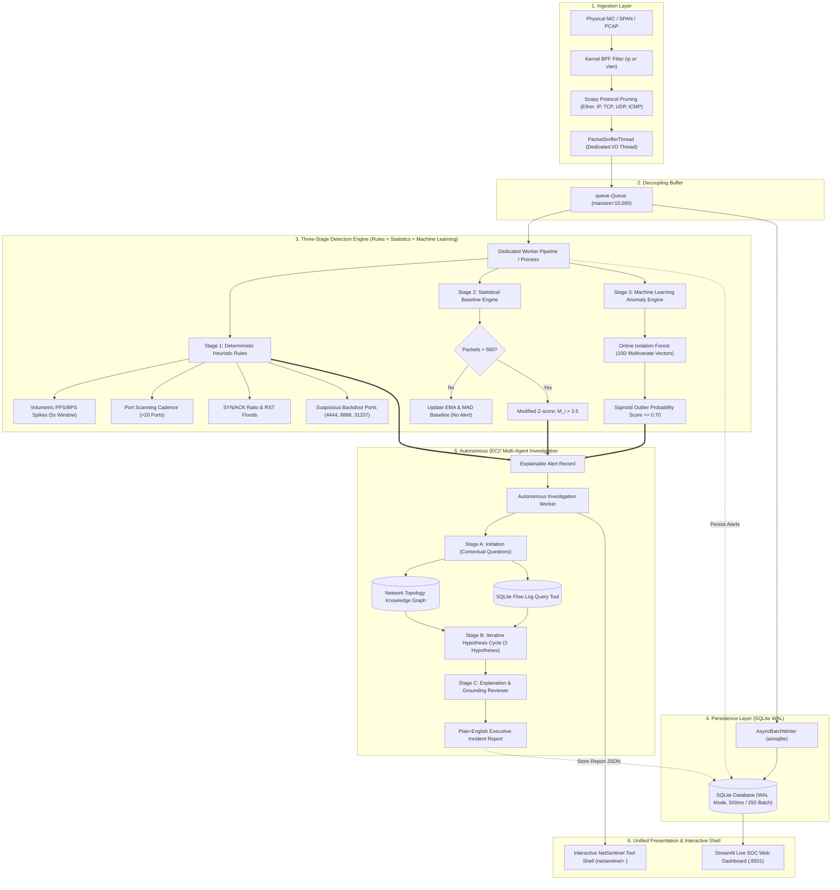

# 🛡️ NetSentinel & (EC)² Multi-Agent Investigation Framework

[](https://github.com/)
[](https://github.com/)
[](https://www.python.org/)
[](https://www.sqlite.org/wal.html)
[](https://scikit-learn.org/)
[](https://streamlit.io/)
[-success?style=for-the-badge&logo=pytest&logoColor=white)](tests/)
[](https://attack.mitre.org/)

```
  _   _      _   ____             _   _            _ 
 | \ | | ___| |_/ ___|  ___ _ __ | |_(_)_ __   ___| |
 |  \| |/ _ \ __\___ \ / _ \ '_ \| __| | '_ \ / _ \ |
 | |\  |  __/ |_ ___) |  __/ | | | |_| | | | |  __/ |
 |_| \_|\___|\__|____/ \___|_| |_|\__|_|_| |_|\___|_|
   Autonomous Cybersecurity Anomaly Detection & (EC)² Forensic RAG
           Developed by Hardik // Hidden Eye Security
```

> **NetSentinel** is an enterprise-grade, explainable cybersecurity network anomaly detection engine and autonomous forensic triage system designed and developed by **Hardik** at **Hidden Eye Security**. It bridges low-level, high-throughput packet capture (`libpcap`/`Scapy`/`psutil`) with machine learning anomaly detection (Isolation Forest), dynamic statistical baselines (EMA + MAD Modified Z-score), and an **8-agent directed graph investigation workflow** that generates plain-English, executive-ready incident reports.

---

## 📑 Table of Contents

- [System Topology & Architecture](#-system-topology--architecture)
- [Key Features](#-key-features)
- [Project Layout](#-project-layout)
- [Installation & Environment Setup](#-installation--environment-setup)
  - [Windows](#1-windows-setup)
  - [Linux (Ubuntu / Debian / RHEL / Arch)](#2-linux-setup)
  - [macOS (Apple Silicon & Intel)](#3-macos-setup)
- [CLI Command & Flag Reference](#-cli-command--flag-reference)
- [Running Modes & Interactive Demonstrations](#-running-modes--interactive-demonstrations)
  - [Mode 1: Animated Live Terminal Monitor](#mode-1-animated-live-terminal-monitor)
  - [Mode 2: Streamlit Visual SOC Dashboard](#mode-2-streamlit-visual-soc-dashboard)
  - [Mode 3: Online Real-Time Packet Sniffing](#mode-3-online-real-time-packet-sniffing)
  - [Mode 4: PCAP Forensic Replay Engine](#mode-4-pcap-forensic-replay-engine)
  - [Mode 5: Synthetic PCAP Trace Generator](#mode-5-synthetic-pcap-trace-generator)
- [Configuration & Environment Variables](#-configuration--environment-variables)
- [MITRE ATT&CK Detection Mapping](#-mitre-attck-detection-mapping)
- [Autonomous (EC)² Multi-Agent Graph](#-autonomous-ec-multi-agent-graph)
- [Database Schema & Forensic Querying](#-database-schema--forensic-querying)
- [Author & Developer Information](#-author--developer-information)
- [Troubleshooting & FAQ](#-troubleshooting--faq)
- [License](#-license)

---

## 🏛️ System Topology & Architecture



---

## ⚡ Key Features

- **Single Execution All-in-One Orchestration (`python main.py`)**: Starts continuous live packet capture, async WAL persistence, 3-stage detection, machine learning, autonomous multi-agent reporting, the Streamlit web dashboard, and drops into an interactive tool CLI shell in a single command.
- **Continuous Zero-Privilege Live Ingestion**: Sniffs raw network packets on any OS (Windows/Linux/macOS) with automatic seamless fallback to `psutil` live socket telemetry on restricted or driverless systems.
- **Kernel-Level Socket Offloading**: Uses BPF filters (`ip or vlan`) and Scapy layer pruning (`[Ether, IP, TCP, UDP, ICMP]`) to eliminate upper-layer parsing overhead.
- **SQLite WAL Mode Engine**: Configured with asynchronous `aiosqlite` and SQLite PRAGMAs:
  - `journal_mode=WAL` (concurrent reads during active writes)
  - `synchronous=NORMAL` (high crash resilience with minimal fsyncs)
  - `busy_timeout=5000` (5-second lock avoidance)
  - `temp_store=MEMORY` (in-RAM temporary indexes)
  - `wal_autocheckpoint=1000` (automatic checkpointing every 1,000 pages)
- **Three-Stage Anomaly Detection Pipeline**:
  - **Stage 1 (Deterministic Rules)**: PPS/BPS spikes, port scan cadences, abnormal SYN/ACK ratios, RST floods, and backdoor ports (`4444`, `8888`, `31337`, `9001`).
  - **Stage 2 (Dynamic Statistical Baselines)**: Exponential Moving Average ($\mu_t = \alpha x_t + (1-\alpha)\mu_{t-1}$) and Median Absolute Deviation Modified Z-Score ($M_i > 3.5$) with a strict 500-packet warm-up suppression gate.
  - **Stage 3 (Machine Learning Isolation Forest)**: Online multivariate learning over 10-dimensional flow vectors (packet length, normalized ports, TCP flags, delta-time, rolling PPS, target unique port ratios).
- **Autonomous (EC)² Multi-Agent Forensic RAG**: 8 specialized agent roles automatically investigate triggered alerts, formulate and evaluate hypotheses, and generate plain-English executive summaries and containment steps saved directly into SQLite.
- **Host PC Diagnostics**: Real-time hardware and interface telemetry (CPU %, RAM %, IP, active listening sockets).
- **Full Privacy Protection**: Automatic payload string redaction (`[REDACTED_PAYLOAD]`).
- **Interactive SOC Web Dashboard**: Auto-refreshing Streamlit dashboard displaying live hardware metrics, ML anomaly gauges, alerts, and expandable (EC)² forensic reports.

---

## 📂 Project Layout

```
netesential/
├── config.py                      # System configuration & SQLite PRAGMA definitions
├── main.py                        # Master All-in-One CLI, live sniffer & orchestrator
├── dashboard.py                   # Modern Streamlit SOC Web Dashboard (:8501)
├── requirements.txt               # Complete Python package dependencies
├── run_demo.ps1                   # Interactive PowerShell launcher
├── README.md                      # Comprehensive deployment & architecture guide
├── .gitignore                     # Git ignore rules
│
├── data/
│   ├── enterprise_demo.pcap       # 702-frame corporate network PCAP dataset
│   ├── sample_enterprise_logs.json# Benign corporate background logs (DNS/AD/Web/SQL)
│   └── attack_scenarios.json      # Injected attack vectors (Scan, C2, Exfil)
│
├── database/
│   ├── models.py                  # SQLAlchemy 2.0 FlowLog, AlertRecord & SystemCommand models
│   └── connection.py              # Async engine factory, WAL PRAGMAs & auto-migration
│
├── ingestion/
│   ├── sniffer.py                 # PacketSnifferThread with raw & psutil hybrid capture
│   └── batch_writer.py            # AsyncBatchWriter for bulk 500ms/250 inserts
│
├── engine/
│   ├── rules.py                   # Stage 1 Heuristics (PPS, Port Scan, SYN/RST, Backdoors)
│   ├── baselines.py               # Stage 2 Statistical Baselines (EMA, MAD Outlier, Warm-up)
│   ├── ml_engine.py               # Stage 3 Machine Learning Isolation Forest (10D vectors)
│   ├── pc_telemetry.py            # Live host machine hardware & socket diagnostics
│   └── detector_worker.py         # DetectorProcess worker (multiprocessing GIL bypass)
│
├── investigation/
│   ├── auto_worker.py             # Autonomous (EC)² Multi-Agent Background Worker
│   ├── knowledge_graph.py         # Network topology knowledge graph (NetworkX)
│   ├── traffic_tool.py            # Forensic SQL traffic query interface
│   ├── agents.py                  # 8 specialized (EC)² forensic agent roles
│   └── workflow.py                # (EC)² directed graph investigation engine
│
└── tests/
    ├── test_phase1.py             # 5,000 synthetic packet WAL persistence test
    ├── test_phase2.py             # Heuristic rules & statistical anomaly tests
    └── test_phase3.py             # Multi-agent RAG forensic verification test
```

---

## 🛠️ Installation & Environment Setup

### 1. Windows Setup

#### Prerequisites
- **Python 3.11+** installed ([python.org](https://www.python.org/downloads/)). Check **"Add python.exe to PATH"** during installation.
- *(Optional for Online Live Capture)*: Install **[Npcap](https://npcap.com/)**. Check **"Install Npcap in WinPcap API-compatible Mode"** during installation. Offline simulation, PCAP replay, and synthetic tests do not require Npcap.

#### PowerShell Commands
```powershell
# 1. Clone repository & navigate to workspace
git clone https://github.com/your-username/netsentinel.git
cd netsentinel

# 2. Create and activate a virtual environment
python -m venv venv
.\venv\Scripts\Activate.ps1

# 3. Upgrade pip and install all required dependencies
python -m pip install --upgrade pip
python -m pip install scapy sqlalchemy aiosqlite greenlet numpy scipy scikit-learn networkx rich streamlit pandas psutil pytest pytest-asyncio

# 4. Verify installation by running test suite
python -m pytest tests/ -v
```

---

### 2. Linux Setup (Ubuntu / Debian / RHEL / Fedora / Arch)

#### Prerequisites
- Python 3.11+
- Development packages for `libpcap`:

```bash
# Ubuntu / Debian
sudo apt update && sudo apt install -y python3-dev python3-venv libpcap-dev build-essential

# Fedora / RHEL
sudo dnf install -y python3-devel libpcap-devel gcc

# Arch Linux
sudo pacman -S python libpcap gcc
```

#### Setup & Raw Capture Permissions
```bash
# 1. Clone repository
git clone https://github.com/your-username/netsentinel.git
cd netsentinel

# 2. Setup virtual environment
python3 -m venv venv
source venv/bin/activate

# 3. Install dependencies
pip install --upgrade pip
pip install scapy sqlalchemy aiosqlite greenlet numpy scipy scikit-learn networkx rich streamlit pandas psutil pytest pytest-asyncio

# 4. (Optional) Allow non-root users to capture raw packets without sudo
sudo setcap cap_net_raw,cap_net_admin=eip $(readlink -f $(which python3))

# 5. Run tests
pytest tests/ -v
```

---

### 3. macOS Setup (Apple Silicon & Intel)

#### Prerequisites
- Homebrew installed ([brew.sh](https://brew.sh))

```zsh
# 1. Install Python and libpcap
brew install python@3.11 libpcap

# 2. Clone repository & create virtual environment
git clone https://github.com/your-username/netsentinel.git
cd netsentinel
python3.11 -m venv venv
source venv/bin/activate

# 3. Install dependencies
pip install --upgrade pip
pip install scapy sqlalchemy aiosqlite greenlet numpy scipy scikit-learn networkx rich streamlit pandas psutil pytest pytest-asyncio

# 4. (Optional for Live Capture) Grant BPF capture permissions
sudo chmod 666 /dev/bpf*

# 5. Verify test suite
pytest tests/ -v
```

---

## 🎛️ CLI Command & Flag Reference

### `main.py` (All-in-One Autonomous NetSentinel Orchestrator)
The central entrypoint starting the continuous packet sniffer, async persistence writer, 3 detection stages, machine learning, autonomous multi-agent reporting, Streamlit web dashboard, and drops into an interactive tool CLI shell in one execution.

| Flag / Option | Type | Default | Description |
| :--- | :--- | :--- | :--- |
| `-i`, `--interface` | `str` | `None` (auto) | Network adapter name (e.g. `"Wi-Fi"`, `"Ethernet"`, `"eth0"`, `"en0"`) |
| `-p`, `--port` | `int` | `8501` | Port number for the Streamlit SOC Web Dashboard |
| `--no-dashboard` | `flag` | `False` | Run in headless CLI mode without spawning the browser dashboard |
| `--no-ml` | `flag` | `False` | Disable Stage 3 Machine Learning Isolation Forest engine |
| `--ml-contamination` | `float` | `0.05` | Expected anomaly contamination ratio for Isolation Forest |
| `--simulate-test` | `flag` | `False` | Inject realistic test attack flows on boot to verify detection & reports |

**Examples:**
```bash
# 1. Standard production launch: live capture, ML, multi-agent reporting, and web dashboard
python main.py

# 2. Run with startup test attack simulation to verify alerts and (EC)² reports immediately
python main.py --simulate-test

# 3. Headless CLI mode on a remote Linux server without GUI dashboard
python main.py --no-dashboard

# 4. Custom web dashboard port
python main.py --port 8080
```

#### Dedicated Interactive Tool Shell (`netsentinel> `)
Once `main.py` boots, you enter NetSentinel's internal command environment without needing to run separate scripts:

| Shell Command | Action / Output |
| :--- | :--- |
| `status` | Displays system uptime, packets logged, live PPS rate, alert counts, and ML status. |
| `pc` | Displays live host machine diagnostics: Hostname, IP, CPU %, RAM %, and active listening sockets. |
| `alerts` | Prints a formatted table of all detected security incidents, severity, and MITRE techniques. |
| `report [id\|latest]` | Prints the complete plain-English (EC)² Multi-Agent forensic deliverable, hypotheses, and containment actions. |
| `ml` | Displays Isolation Forest model state, feature vector space (10D), samples accumulated, and threshold. |
| `simulate <scan\|c2\|dos>` | Injects an attack simulation (`scan` = port scan, `c2` = exfiltration, `dos` = volumetric burst) into live stream. |
| `dashboard` | Displays the dashboard URL and launches default web browser. |
| `clear` | Clears terminal screen. |
| `exit` / `quit` | Safely flushes database buffers, stops background threads and dashboard, and cleanly exits. |

---

### `live_capture.py` (Real-Time Live Network Sniffing)
| Flag / Option | Type | Default | Description |
| :--- | :--- | :--- | :--- |
| `--interface` | `str` | `None` (auto) | Network adapter name (e.g. `"Wi-Fi"`, `"Ethernet"`, `"eth0"`, `"en0"`) |
| `--duration` | `int` | `30` | Capture duration in seconds before shutting down cleanly |

**Examples:**
```bash
# Auto-detect interface and capture for 30 seconds
python live_capture.py

# Capture on Wi-Fi adapter for 2 minutes
python live_capture.py --interface "Wi-Fi" --duration 120

# Linux capture on eth0
sudo python live_capture.py --interface "eth0" --duration 60
```

---

### `replay_demo.py` (Forensic PCAP Replay Engine)
| Flag / Option | Type | Default | Description |
| :--- | :--- | :--- | :--- |
| `--pcap` | `str` | `data/enterprise_demo.pcap` | Path to any `.pcap` or `.pcapng` capture file to ingest and triage |

**Examples:**
```bash
# Replay default bundled enterprise dataset
python replay_demo.py

# Replay a custom corporate network capture
python replay_demo.py --pcap /path/to/suspicious_traffic.pcap
```

---

### `generate_demo_data.py` (Synthetic Enterprise Dataset Generator)
| Flag / Option | Type | Default | Description |
| :--- | :--- | :--- | :--- |
| `--output` | `str` | `data/enterprise_demo.pcap` | Output filepath for the generated PCAP capture |

**Example:**
```bash
# Generate a fresh 700+ packet capture with 4 cyberattack scenarios
python generate_demo_data.py --output data/enterprise_demo.pcap
```

---

### `run_demo.ps1` (PowerShell Automation Launcher)
| Switch | Description |
| :--- | :--- |
| *(None)* | Displays interactive multi-choice terminal menu with default option [1] launching All-in-One |
| `-AllInOne` | Immediately launches the unified NetSentinel engine (`python main.py`) |
| `-SimulateTest` | Combines with `-AllInOne` to inject startup attack simulation |
| `-Dashboard` | Starts the standalone Streamlit browser dashboard |
| `-Replay` | Replays `data/enterprise_demo.pcap` through the pipeline |
| `-RunTests` | Runs all 11 unit tests across all phases |

**Examples:**
```powershell
.\run_demo.ps1               # Interactive menu
.\run_demo.ps1 -AllInOne     # Launch complete All-in-One system
.\run_demo.ps1 -Dashboard    # Launch Web SOC dashboard only
.\run_demo.ps1 -RunTests     # Run verification suite
```

---

## 🚀 Running Modes & Interactive Demonstrations

### Mode 0: All-in-One Autonomous System (Primary Recommended)
The fastest and most powerful way to run NetSentinel. A single execution starts:
1. Continuous packet sniffer (captures real computer traffic via hybrid Scapy/psutil).
2. Asynchronous SQLite WAL persistence (non-blocking 500ms batches).
3. Stage 1 Heuristics, Stage 2 Statistical Baselines, and Stage 3 Machine Learning Isolation Forest.
4. Autonomous (EC)² Multi-Agent forensic investigator (auto-investigates threats & writes reports to DB).
5. Streamlit SOC Web Dashboard (`http://localhost:8501`).
6. Interactive `netsentinel> ` terminal shell with live diagnostics.

```bash
python main.py
```

Or with an immediate test attack simulation to test the full pipeline on boot:
```bash
python main.py --simulate-test
```

---

### Mode 1: Animated Live Terminal Monitor
Streams real enterprise telemetry in real time with an animated PPS throughput gauge, live scrolling frame table, instant alert popups, and full (EC)² incident reports:

```bash
python live_demo.py
```

```
┌──────────────────────────────── NETWORK TELEMETRY ────────────────────────────────┐
│  [*] Phase: DETECTING        >> NetSentinel Live Monitor <<          Alerts: 3    │
│  Packets: 592               PPS [145] #####################.......... Bytes: 102K │
└───────────────────────────────────────────────────────────────────────────────────┘
┌───────────────────────────────── [LIVE PACKET FEED] ───────────────────────────────┐
│ TIME     PROTO SOURCE                  -> DESTINATION           FLAGS   LEN       │
│ 14:22:01 TCP   192.168.1.150:50021     -> 10.0.0.5:443          S        60       │
│ 14:22:01 TCP   192.168.1.150:50022     -> 10.0.0.5:445          S        60       │
│ 14:22:02 TCP   192.168.1.100:51234     -> 198.51.100.44:4444    PA       84       │
│ 14:22:03 TCP   192.168.1.100:51235     -> 10.0.0.5:1433         PA     5500       │
└───────────────────────────────────────────────────────────────────────────────────┘
┌────────────────────────────────── [! ALERTS !] ───────────────────────────────────┐
│   SEV   │ MITRE ATT&CK                  │ SOURCE -> TARGET        │ REASON        │
│  HIGH   │ T1046: Network Service Disc   │ 192.168.1.150 -> 10.0.0 │ Port scan...  │
│  HIGH   │ T1571: Non-Standard Port      │ 192.168.1.100 -> 198.51 │ Backdoor 4444 │
│ CRITICAL│ T1041: Exfiltration Over C2   │ 192.168.1.100 -> 10.0.0 │ M_i: 81.78    │
└───────────────────────────────────────────────────────────────────────────────────┘
```

---

### Mode 2: Streamlit Visual SOC Dashboard & Interactive Operations Center
Launches the browser-based Security Operations Center dashboard that auto-refreshes every 2 seconds:

```bash
streamlit run dashboard.py
```
- **URL**: `http://localhost:8501` (opens automatically on `python main.py`)
- **Key Capabilities**:
  - **Live Wireshark Packet Inspector**: Color-coded frame list (TCP SYN violet, standard TCP slate, UDP teal, anomalies red), frame search/protocol/port filters, collapsible protocol layer tree (Frame, IPv4, TCP/UDP), and realistic 16-bytes-per-line Hex & ASCII payload dump with security redaction.
  - **Embedded Web Terminal & Simulation Controller**: Monospace interactive terminal directly in the web UI. Type commands (`status`, `pc`, `alerts`, `report latest`, `ml`) or click quick-action buttons to inject live cyberattack simulations (`Port Scan T1046`, `C2 Exfiltration T1041`, `DoS Volume Spike T1498`).
  - **(EC)² Autonomous Forensic Incident Deliverables**: Expandable incident accordions with executive forensic narratives, evaluated hypothesis chips (`SUPPORTED`, `REFUTED`, `INCONCLUSIVE`), and actionable SOC containment directives.
  - **Host PC Hardware Telemetry**: Live CPU Utilization %, RAM Used/Total GB progress bars, Host IP, and active listening network socket count.
  - **Machine Learning & Statistical Baselines**: Isolation Forest 10D feature breakdown, contamination parameters, and traffic protocol distributions.

---

### Mode 3: Online Real-Time Packet Sniffing
Captures live frames directly from your machine's physical network adapter:

```bash
# Windows (requires Npcap)
python live_capture.py --interface "Wi-Fi" --duration 60

# Linux (requires raw socket capability or sudo)
sudo python live_capture.py --interface "eth0" --duration 60
```

---

### Mode 4: PCAP Forensic Replay Engine
Replays pre-recorded PCAP capture files into SQLite WAL mode, triggers analytical rules, and runs the (EC)² multi-agent investigation:

```bash
python replay_demo.py --pcap data/enterprise_demo.pcap
```

---

### Mode 5: Synthetic PCAP Trace Generator
Generates realistic corporate background traffic (Active Directory, Kerberos, DNS, SMB, SQL) followed by 4 weaponized cyberattack scenarios:

```bash
python generate_demo_data.py --output data/enterprise_demo.pcap
```

---

## ⚙️ Configuration & Environment Variables

All parameters can be tuned via environment variables without modifying source code:

| Environment Variable | Default | Description |
| :--- | :--- | :--- |
| `NETSENTINEL_DB_PATH` | `netsentinel.db` | Path to the SQLite database file |
| `NETSENTINEL_DB_URL` | `sqlite+aiosqlite:///netsentinel.db` | SQLAlchemy async connection URI |
| `NETSENTINEL_BUFFER_MAXSIZE` | `10000` | Max capacity of packet ring buffer |
| `NETSENTINEL_BATCH_SIZE` | `250` | Number of records to accumulate before bulk insert |
| `NETSENTINEL_BATCH_FLUSH_INTERVAL`| `0.5` | Max latency (seconds) before flushing batched records |
| `NETSENTINEL_BPF_FILTER` | `"ip or vlan"` | BPF expression passed to kernel socket filter |
| `PPS_THRESHOLD` | `100.0` | Packets-per-second threshold per source IP |
| `BPS_THRESHOLD` | `1048576.0` | Bytes-per-second threshold (1 MB/s) |
| `PORT_SCAN_THRESHOLD` | `20` | Unique destination ports within window triggering scan alert |
| `PORT_SCAN_WINDOW_SECONDS` | `5.0` | Temporal sliding window for port scan tracking |
| `SYN_FLOOD_THRESHOLD` | `50` | Minimum SYN frames required to evaluate SYN/ACK ratio |
| `SYN_ACK_RATIO_THRESHOLD` | `3.0` | Ratio of SYN to ACK flags indicative of half-open flood |
| `RST_COUNT_THRESHOLD` | `20` | Excessive TCP RST flags within 5s window |
| `EMA_ALPHA` | `0.1` | Exponential Moving Average smoothing factor $\alpha$ |
| `MAD_MODIFIED_Z_THRESHOLD` | `3.5` | Robust outlier threshold ($M_i$) |
| `WARMUP_PACKET_COUNT` | `500` | Initial packets used strictly for baseline calibration |
| `ROLLING_WINDOW_SIZE` | `100` | Rolling observation buffer size for MAD calculation |

---

## 🎯 MITRE ATT&CK Detection Mapping

| Subsystem Stage | Detected Pattern | MITRE Tactic | MITRE Technique | Default Severity |
| :--- | :--- | :--- | :--- | :--- |
| **Stage 1 (Rule)** | Volumetric PPS Surge | `TA0040: Impact` | `T1498: Network Denial of Service` | `HIGH` |
| **Stage 1 (Rule)** | Bandwidth BPS Surge | `TA0010: Exfiltration` | `T1048: Exfiltration Over Alternative Protocol` | `CRITICAL` |
| **Stage 1 (Rule)** | Horizontal/Vertical Port Scan | `TA0007: Discovery` | `T1046: Network Service Discovery` | `HIGH` |
| **Stage 1 (Rule)** | SYN-to-ACK Ratio Disparity | `TA0040: Impact` | `T1499: Endpoint Denial of Service` | `HIGH` |
| **Stage 1 (Rule)** | Elevated TCP RST Cadence | `TA0007: Discovery` | `T1046: Network Service Discovery` | `MEDIUM` |
| **Stage 1 (Rule)** | Backdoor Port (`4444`, `31337`, `6667`) | `TA0011: Command and Control` | `T1571: Non-Standard Port` | `HIGH` |
| **Stage 2 (Stat)** | Post-Warmup Payload Outlier ($M_i > 3.5$) | `TA0010: Exfiltration` | `T1041: Exfiltration Over C2` | `HIGH` / `CRITICAL` |

---

## 🧠 Autonomous (EC)² Multi-Agent Graph

When an alert is flagged, it is dispatched to the **(EC)² (Explainable Cybersecurity Evaluation & Contextualization)** directed multi-agent graph:

```
                  ┌────────────────────────┐
                  │ Anomalous Alert Record │
                  └───────────┬────────────┘
                              │
                    [Stage A: Initiation]
                              ▼
           ┌──────────────────────────────────────┐
           │ Contextual Question Generator Agent  │
           └──────────────────┬───────────────────┘
                              ▼
           ┌──────────────────────────────────────┐
           │      Evidence Gathering Agent        │
           └──┬────────────────────────────────┬──┘
              │ (Query Knowledge Graph)        │ (Query SQL Telemetry)
              ▼                                ▼
       [Device Roles/Subnets]           [Flow Hist/Flags]
                              │
                    [Stage B: Hypothesis]
                              ▼
           ┌──────────────────────────────────────┐
           │      Hypothesis Generator Agent      │
           │ (1. Attack / 2. Admin / 3. Benign)   │
           └──────────────────┬───────────────────┘
                              ▼
           ┌──────────────────────────────────────┐
           │            Planner Agent             │
           │   (Targeted Forensic Questions)      │
           └──────────────────┬───────────────────┘
                              ▼
           ┌──────────────────────────────────────┐
           │      Hypothesis Evaluator Agent      │
           │    (Supported / Refuted / Unres)     │
           └──────────────────┬───────────────────┘
                              ▼
           ┌──────────────────────────────────────┐
           │         Flow Evaluator Agent         │
           │     (Enforce Max 1 Retry Gate)       │
           └──────────────────┬───────────────────┘
                              │
                    [Stage C: Conclusion]
                              ▼
           ┌──────────────────────────────────────┐
           │          Explanation Agent           │
           │    (Plain-English Executive Report)  │
           └──────────────────┬───────────────────┘
                              ▼
           ┌──────────────────────────────────────┐
           │      Explanation Reviewer Agent      │
           │    (Grounding Check / Zero Halluc)   │
           └──────────────────┬───────────────────┘
                              ▼
                  ┌────────────────────────┐
                  │ Approved Action Report │
                  └────────────────────────┘
```

---

## 🗄️ Database Schema & Forensic Querying

NetSentinel stores all normalized flows and alerts in `netsentinel.db`:

### `flow_logs` Table
- `id` (INTEGER, PK, Autoincrement)
- `timestamp` (REAL, Indexed)
- `source_ip` (TEXT(45), Indexed)
- `destination_ip` (TEXT(45), Indexed)
- `source_port` (INTEGER, Nullable)
- `destination_port` (INTEGER, Indexed, Nullable)
- `protocol` (TEXT(10))
- `packet_length` (INTEGER)
- `tcp_flags` (TEXT(10), Nullable)
- `window_size` (INTEGER, Nullable)

### `alerts` Table
- `alert_id` (TEXT(36), PK, UUID)
- `timestamp` (REAL, Indexed)
- `severity` (TEXT(20))
- `detection_source` (TEXT(50))
- `mitre_tactic` (TEXT(100))
- `mitre_technique` (TEXT(100))
- `source_ip` (TEXT(45), Indexed)
- `destination_ip` (TEXT(45), Indexed)
- `destination_port` (INTEGER, Nullable)
- `protocol` (TEXT(10))
- `trigger_reason` (TEXT)
- `observed_value` (REAL, Nullable)
- `baseline_expected` (REAL, Nullable)
- `deviation_score` (REAL, Nullable)
- `investigation_report` (TEXT, Nullable, JSON Serialized)

---

## 👨‍💻 Author & Developer Information

NetSentinel was conceived, designed, and developed by:

- **Lead Developer & Systems Architect**: **Hardik**
- **Security Research Lab / Organization**: **Hidden Eye Security**
- **Domain Focus**: Autonomous Cyber Defense Systems, Machine Learning Anomaly Detection, Multi-Agent Forensic Investigation Graphs ((EC)² RAG), and Zero-Privilege High-Concurrency Network Observability.

---

## ❓ Troubleshooting & FAQ

#### Q1: "WARNING: No libpcap provider available! pcap won't be used"
- **Reason**: On Windows, Scapy displays this warning when Npcap is not installed.
- **Solution**: NetSentinel features an automatic zero-privilege fallback engine (`psutil.net_connections`). It captures real machine network traffic seamlessly without requiring Npcap or administrator privileges. If raw packet frame dissection is desired, you can optionally install **[Npcap](https://npcap.com/)** in WinPcap-compatible mode.

#### Q2: UnicodeEncodeError: 'charmap' codec can't encode character...
- **Reason**: Windows PowerShell or `cmd.exe` running under legacy `cp1252` encoding instead of UTF-8.
- **Solution**: NetSentinel automatically reconfigures `sys.stdout` to UTF-8 with character replacement fallback and uses ASCII-resilient indicators. You can also enforce UTF-8 in PowerShell:
  ```powershell
  $env:PYTHONIOENCODING = "utf-8"
  [Console]::OutputEncoding = [System.Text.Encoding]::UTF8
  ```

#### Q3: How do I deploy NetSentinel to monitor an entire corporate network?
- Configure a **SPAN (Port Mirror)** or connect a passive optical TAP on your core switch.
- Connect the mirrored interface to a dedicated sensor NIC on your server.
- Bind NetSentinel to that interface: `python main.py --interface "eth1"`.

---

## 📄 License

This project is licensed under the Apache 2.0 License. Designed and developed by **Hardik** at **Hidden Eye Security**.

This project is licensed under the Apache 2.0 License. See `LICENSE` for details.
