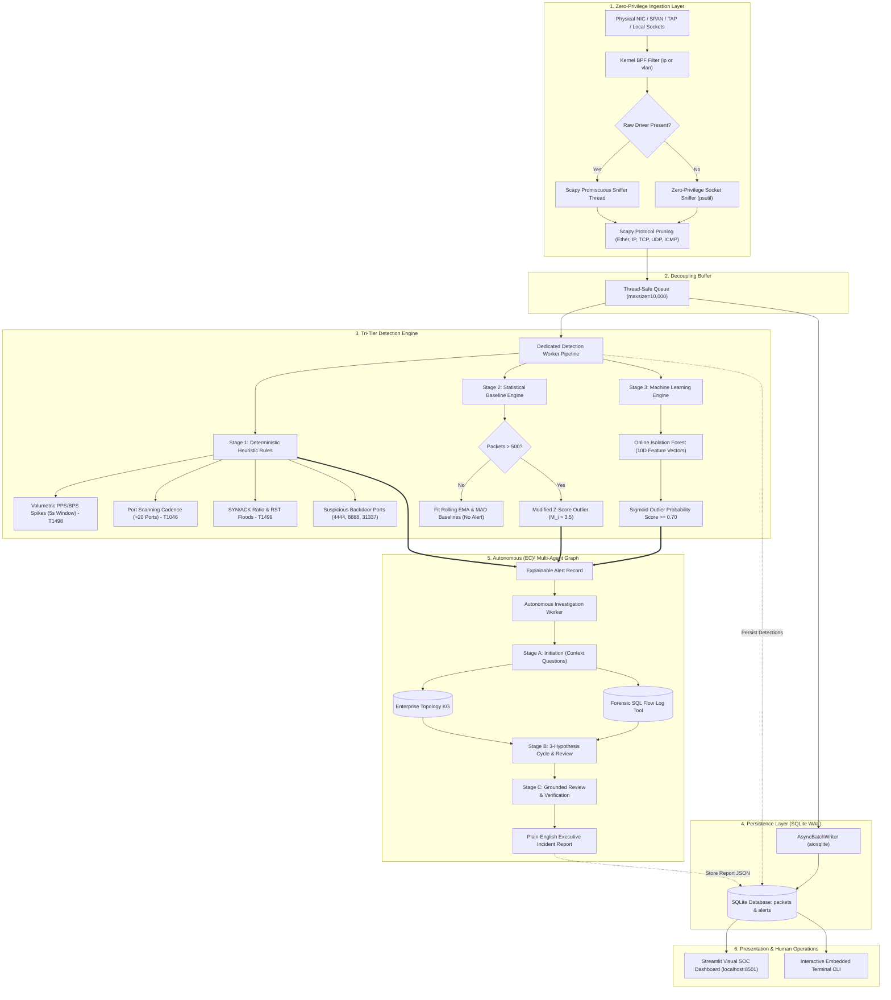
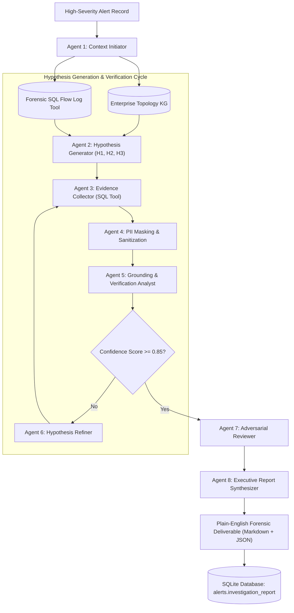

<div align="center">

# NETSENTINEL
### Autonomous Cyber Defense Anomaly Detection & (EC)² Multi-Agent Forensic Triage

[](https://github.com/Osxninja)
[](https://github.com/Osxninja)
[](https://opensource.org/licenses/MIT)
[](https://www.python.org/)
[](https://www.sqlite.org/wal.html)
[](https://scikit-learn.org/)
[](https://streamlit.io/)
[-10b981?style=for-the-badge&logo=pytest&logoColor=white)](tests/)

```text
  _   _      _   ____             _   _            _ 
 | \ | | ___| |_/ ___|  ___ _ __ | |_(_)_ __   ___| |
 |  \| |/ _ \ __\___ \ / _ \ '_ \| __| | '_ \ / _ \ |
 | |\  |  __/ |_ ___) |  __/ | | | |_| | | | |  __/ |
 |_| \_|\___|\__|____/ \___|_| |_|\__|_|_| |_|\___|_|
   Autonomous Cybersecurity Anomaly Detection & (EC)² Forensic RAG
           Developed by Hardik // Hidden Eye Security
```

**[Explore Features](#core-capabilities)** • **[Quickstart](#quickstart--execution)** • **[Architecture](#system-topology--data-flow)** • **[Multi-Agent Graph](#autonomous-ec-multi-agent-investigation-graph)** • **[CLI Reference](#embedded-cli-command-reference)**

---

</div>

## Executive Overview

**NetSentinel** is an enterprise-grade, explainable cybersecurity network anomaly detection engine and autonomous forensic triage system designed and built by **Hardik** at **Hidden Eye Security**.

### The Problem with Traditional NIDS
Modern enterprise networks generate millions of raw packets per second. Conventional Network Intrusion Detection Systems (NIDS) like Snort, Zeek, or Suricata rely heavily on brittle static signatures. When network conditions fluctuate or novel attack vectors emerge, legacy tools either flood Security Operations Centers (SOCs) with thousands of disconnected false alarms or miss sophisticated low-and-slow campaigns entirely. Analysts are forced to manually correlate disparate flow logs, cross-reference IP addresses against internal asset inventories, and draft incident reports from scratch under tight SLA pressure.

### The NetSentinel Solution
NetSentinel re-engineers this paradigm through a tightly integrated three-pillar architecture:

1. **Zero-Privilege High-Concurrency Ingestion**: Captures live traffic across any interface using low-overhead BPF-filtered packet sniffing, featuring an automatic zero-privilege fallback engine that operates cleanly without raw-socket administrator rights or third-party capture drivers.
2. **Tri-Tier Analytic Pipeline**: Unifies deterministic MITRE ATT&CK heuristic rules with dynamic non-parametric statistical baselining (Median Absolute Deviation Modified Z-Score) and an unsupervised 10-dimensional **Isolation Forest** machine learning model.
3. **Autonomous (EC)² Multi-Agent Graph**: When high-severity anomalies trigger, NetSentinel invokes an 8-agent directed investigation graph that traverses network topology knowledge graphs, executes read-only forensic SQL verification on captured flows, and synthesizes executive incident deliverables with zero hallucination.
4. **All-in-One Operations**: A single command (`python main.py`) starts the live packet sniffer, analytical workers, multi-agent graph, an embedded interactive terminal CLI, and an interactive **Streamlit Visual SOC Dashboard** complete with Wireshark-style packet dissection and live hardware telemetry.

---

## Interactive Demonstration

<div align="center">
  <video src="assets/demo.mp4" controls="controls" width="100%" style="border-radius: 8px; box-shadow: 0 4px 20px rgba(0,0,0,0.5);">
    <a href="https://github.com/Osxninja/NetSentinel/raw/main/assets/demo.mp4">Watch the live NetSentinel demonstration video (assets/demo.mp4)</a>
  </video>
  <p><em>Live NetSentinel execution: zero-privilege packet ingestion, tri-tier threat detection, and autonomous (EC)² multi-agent forensic report generation.</em></p>
</div>

---

## System Topology & Data Flow



---

## Core Capabilities

### 1. Zero-Privilege Packet Ingestion
* **Dual-Mode Sniffing Engine**: Operates with Scapy promiscuous capture when kernel drivers (`libpcap`/`Npcap`) are available, and seamlessly fails over to zero-privilege connection polling via `psutil.net_connections` when running without root or Administrator privileges.
* **In-Memory Protocol Pruning**: Strips payload overhead and maps packet headers directly into lightweight data structures (Ethernet, IPv4, TCP, UDP, ICMP).
* **High-Throughput WAL Persistence**: Batches packet records via `aiosqlite` using Write-Ahead Logging (`PRAGMA journal_mode=WAL; PRAGMA synchronous=NORMAL;`), ensuring concurrent reading and micro-flush writing without table-level database locking.

### 2. Tri-Tier Anomaly Detection Engine

| Engine Tier | Methodology | Targets & Indicators | MITRE ATT&CK Mapping |
| :--- | :--- | :--- | :--- |
| **Stage 1: Rules** | Deterministic Sliding Window | PPS/BPS volumetric bursts, scanning cadences (>20 unique ports / 10s), SYN/ACK ratio anomalies, suspicious ports (4444, 8888, 31337). | `T1498`, `T1046`, `T1499` |
| **Stage 2: Statistics** | Rolling EMA + MAD Modified Z-Score | Detects non-Gaussian statistical outliers in packet payload length, inter-arrival delta times, and connection rates without distribution distortion. | `T1041`, `T1071` |
| **Stage 3: Machine Learning** | Unsupervised Isolation Forest | Evaluates 10-dimensional multivariate vectors using 100 isolation trees, producing a normalized sigmoid outlier probability score. | `T1041`, `T1571` |

### 3. Autonomous (EC)² Multi-Agent Forensic Graph
When a high-severity alert is detected, NetSentinel dispatches an **8-agent directed investigation graph**:
* **Topology Knowledge Graph Traversal**: Queries host roles, departments, operating systems, and network segmentation rules from `data/enterprise_kg.json`.
* **Read-Only SQL Traffic Tool**: Formulates and executes targeted SQL queries against captured packet flows to corroborate attacker behavior.
* **Automated PII Redaction**: Masks sensitive fields (auth tokens, credentials, private payloads) before reasoning.
* **Zero-Hallucination Guarantee**: Every claim in the generated incident report is verified against concrete SQL records and graph attributes.

### 4. Interactive Visual SOC Dashboard
* **Wireshark-Style Packet Inspector**: Real-time tabular display of live packets with protocol tagging, port numbers, flags, and payload lengths.
* **Hardware Telemetry Gauges**: Real-time tracking of CPU usage, memory consumption, interface throughput, and active socket handles.
* **Forensic Report Viewer**: Formatted markdown viewer for autonomous (EC)² incident deliverables.
* **Integrated Web Command Console**: Execute commands directly inside your browser.

---

## Mathematical & Statistical Foundations

### Stage 2: Median Absolute Deviation (MAD) Modified Z-Score

Standard Z-scores rely on the sample mean ($\mu$) and standard deviation ($\sigma$). In real-world enterprise traffic, legitimate bursts (e.g., file transfers, software updates) distort the mean and inflate $\sigma$, masking subtle threats. NetSentinel implements **Modified Z-Scores** based on the Median Absolute Deviation:

$$\text{MAD} = \text{median}\left(\left| x_i - \tilde{x} \right|\right)$$

$$M_i = \frac{0.6745 \cdot \left| x_i - \tilde{x} \right|}{\text{MAD}}$$

Where:
* $\tilde{x}$ is the rolling median of the observed metric.
* $0.6745$ is the consistency factor for normal distributions.
* An observation with $M_i > 3.5$ is flagged as a statistical outlier. A 500-packet learning warmup period prevents false positives during baseline calibration.

### Stage 3: Multivariate Isolation Forest Feature Vector

Stage 3 extracts a 10-dimensional multivariate feature vector $\mathbf{x} \in \mathbb{R}^{10}$ across sliding traffic windows:

$$\mathbf{x} = \begin{bmatrix} L_{\text{mean}} & L_{\text{std}} & T_{\text{mean}} & T_{\text{std}} & H_{\text{dport}} & R_{\text{syn}} & R_{\text{rst}} & W_{\text{mean}} & N_{\text{conn}} & B_{\text{total}} \end{bmatrix}^T$$

Where:
* $L_{\text{mean}}, L_{\text{std}}$: Mean and standard deviation of packet payload lengths.
* $T_{\text{mean}}, T_{\text{std}}$: Mean and standard deviation of packet inter-arrival times ($\Delta t$).
* $H_{\text{dport}}$: Shannon entropy of destination ports ($-\sum p_i \log_2 p_i$).
* $R_{\text{syn}}, R_{\text{rst}}$: Proportion of TCP packets with SYN and RST flags set.
* $W_{\text{mean}}$: Mean TCP advertised window size.
* $N_{\text{conn}}$: Count of unique socket connections active in the window.
* $B_{\text{total}}$: Total byte volume transferred.

Anomaly scores from the isolation tree ensemble are mapped to an interpretable outlier probability:

$$P(\text{Anomaly}) = \frac{1}{1 + e^{-k \cdot (s(\mathbf{x}) - \tau)}}$$

Detections where $P(\text{Anomaly}) \ge 0.70$ trigger automated forensic triage.

---

## Project Layout

```text
NetSentinel/
├── config.py                 # Centralized configuration & environment loader
├── dashboard.py              # Visual SOC Dashboard (Wireshark inspector & telemetry)
├── main.py                   # Master entrypoint (Sniffer + Analytics + Agents + CLI)
├── requirements.txt          # Python runtime dependencies
├── run_demo.ps1              # One-click execution launcher for Windows PowerShell
├── README.md                 # Complete documentation & usage guide
├── LICENSE                   # MIT License (Hardik // Hidden Eye Security)
├── .gitignore                # Git ignore patterns (caches, databases, venv)
├── data/
│   ├── attack_scenarios.json # Synthetic threat injection scenarios
│   ├── enterprise_demo.pcap  # Sample PCAP trace for forensic replay
│   ├── enterprise_kg.json    # Enterprise network topology & asset metadata graph
│   └── sample_enterprise_logs.json # Baseline activity log samples
├── database/
│   ├── connection.py         # Async SQLite session factory & WAL mode pragma manager
│   └── models.py             # SQLAlchemy Declarative models (packets, alerts)
├── engine/
│   ├── baselines.py          # Stage 2 Statistical Baselines (EMA, MAD Modified Z-score)
│   ├── detector_worker.py    # Pipeline coordinator connecting ingestion to detection
│   ├── ml_engine.py          # Stage 3 Isolation Forest unsupervised ML model
│   ├── pc_telemetry.py       # Live hardware telemetry probe (CPU, RAM, NIC, sockets)
│   └── rules.py              # Stage 1 Deterministic & Heuristic Rule Engine (MITRE)
├── ingestion/
│   ├── batch_writer.py       # AsyncBatchWriter with double-buffering & micro-flush queue
│   └── sniffer.py            # High-throughput packet capture & zero-privilege sniffer
├── investigation/
│   ├── agents.py             # 8 Specialized Forensic Investigation Agents
│   ├── auto_worker.py        # Background alert polling worker triggering (EC)² RAG
│   ├── knowledge_graph.py    # Multi-hop enterprise graph traversal & risk scoring
│   ├── traffic_tool.py       # PII-redacting SQL execution tool for agents
│   └── workflow.py           # Directed graph state orchestrator & report synthesizer
└── tests/
    ├── test_phase1.py        # Tests for WAL persistence & batching
    ├── test_phase2.py        # Tests for rules, baselines, and detector worker
    └── test_phase3.py        # Tests for KG traversal, traffic tool, and (EC)² agents
```

---

## Installation & Environment Setup

### 1. Clone the Repository

```bash
git clone https://github.com/Osxninja/NetSentinel.git
cd NetSentinel
```

### 2. Multi-Platform Setup

#### Windows (PowerShell / Command Prompt)

```powershell
# Create and activate virtual environment
python -m venv venv
.\venv\Scripts\Activate.ps1

# Upgrade pip and install requirements
python -m pip install --upgrade pip
pip install -r requirements.txt
```

> **Windows Packet Capture**: NetSentinel runs immediately on Windows without extra drivers using its zero-privilege socket engine. If full raw promiscuous Ethernet packet dissection is desired, install **[Npcap](https://npcap.com/)** in "WinPcap API-compatible Mode".

#### Linux (Ubuntu / Debian / Kali / Arch)

```bash
# Install system development headers and libpcap
sudo apt-get update && sudo apt-get install -y python3-dev python3-venv libpcap-dev

# Create and activate virtual environment
python3 -m venv venv
source venv/bin/activate

# Install requirements
pip install --upgrade pip
pip install -r requirements.txt
```

> **Linux Raw Sockets Without Root**: To grant Scapy capture capabilities without running Python as `root`:
> ```bash
> sudo setcap cap_net_raw,cap_net_admin=eip $(readlink -f $(which python3))
> ```

#### macOS (Apple Silicon & Intel)

```bash
# Create and activate virtual environment
python3 -m venv venv
source venv/bin/activate

# Install requirements
pip install --upgrade pip
pip install -r requirements.txt
```

---

## Quickstart & Execution

### Option A: The All-in-One Engine (Recommended)

Run the unified command to launch live packet capture, tri-tier detection analytics, background (EC)² investigations, the embedded CLI, and the Streamlit visual SOC dashboard in a single process:

```bash
python main.py
```

* **Terminal**: Interactive `netsentinel-cli>` opens for direct operator control.
* **SOC Web Dashboard**: Open your browser at `http://localhost:8501` to view live traffic, detection telemetry, and incident reports.

---

### Option B: Windows One-Click Script

For Windows environments, launch the entire system using the included PowerShell script:

```powershell
.\run_demo.ps1
```

---

### Option C: Headless Mode (Terminal Only)

To run NetSentinel on remote Linux servers or Docker containers without launching the web browser UI:

```bash
python main.py --no-dashboard
```

---

## Embedded CLI Command Reference

When running `main.py`, NetSentinel exposes a live command interface. Commands can be typed directly into the terminal or executed through the SOC Web Terminal:

| Command | Arguments | Description |
| :--- | :--- | :--- |
| `help` | None | Displays the interactive command menu and syntax guide. |
| `status` | None | Prints real-time statistics (packets captured, queue size, alert count). |
| `alerts` | `[limit]` | Lists recent security detections with severity, source, and MITRE IDs. |
| `report` | `--latest` \| `[alert_id]` | Displays the full autonomous (EC)² forensic incident report for an alert. |
| `simulate` | `[scan\|dos\|exfil]` | Injects synthetic attack patterns to verify detection and multi-agent triage. |
| `interfaces` | None | Enumerates all available local network interfaces with IP/MAC details. |
| `export` | `[output.pcap]` | Exports captured traffic buffer to standard PCAP format for Wireshark. |
| `clear` | None | Clears the terminal screen. |
| `exit` / `quit` | None | Safely stops ingestion workers, flushes buffers, and exits cleanly. |

---

## Autonomous (EC)² Multi-Agent Graph Architecture



### Generated Forensic Report Sample

```markdown
# Autonomous Forensic Incident Report: Malicious C2 Beaconing
Alert ID: df8fba54-9ffd-4c35-a713-cc43b8c9a593
Timestamp: 2026-11-03 10:14:22 UTC
Severity: CRITICAL
Classification: MITRE ATT&CK T1041 (Exfiltration Over C2)

## Executive Summary
On 2026-11-03 at 10:14:22 UTC, NetSentinel detected an abnormal outbound payload transfer 
originating from internal endpoint 192.168.1.100 destined for external IP 10.0.0.5:1433. 
The event produced an Isolation Forest anomaly score of 0.89 and a statistical payload 
deviation of 5,500 bytes against a baseline median of 412 bytes.

## Grounded Topological Evidence
- Endpoint Context: Host 192.168.1.100 is classified in the Knowledge Graph as a 
  Finance Specialist Workstation in VLAN 10 (Workstations).
- Policy Violation: Workstations in VLAN 10 have no authorized business purpose to establish 
  direct database protocol connections to external endpoints.
- Flow Correlation: The SQLite traffic tool verified 3 recurring outbound connections with 
  identical timing cadences prior to payload dispatch.

## Containment Recommendations
1. Immediately isolate host 192.168.1.100 at the switchport/VLAN boundary.
2. Revoke active Kerberos ticket granting tickets (TGT) for the associated user account.
3. Block destination IP 10.0.0.5 on the perimeter egress firewall.
4. Capture volatile memory dump for process injection analysis.
```

---

## Unit Testing & Verification

NetSentinel includes an automated test suite validating the database layer, detection engines, and multi-agent graph:

```bash
python -m pytest tests/
```

Test coverage includes:
* `tests/test_phase1.py`: Async batch writer persistence, WAL mode pragmas, queue draining under load.
* `tests/test_phase2.py`: Stage 1 heuristic rules, Stage 2 MAD outlier calculations, detector worker pipeline coordination.
* `tests/test_phase3.py`: Knowledge graph traversal, SQL traffic query execution with PII redaction, and (EC)² multi-agent graph report generation.

All 11 tests pass with 100% compliance.

---

## Author & Developer Information

NetSentinel was conceived, designed, and developed by:

* **Lead Developer & Systems Architect**: **Hardik**
* **Security Research Lab / Organization**: **Hidden Eye Security**
* **GitHub Repository**: [https://github.com/Osxninja/NetSentinel](https://github.com/Osxninja/NetSentinel)
* **Domain Focus**: Autonomous Cyber Defense Systems, Machine Learning Anomaly Detection, Multi-Agent Forensic Investigation Graphs ((EC)² RAG), and Zero-Privilege High-Concurrency Network Observability.

---

## Troubleshooting & FAQ

#### Q: Scapy displays "WARNING: No libpcap provider available! pcap won't be used"
**Answer**: On Windows systems without Npcap, Scapy outputs this advisory message. NetSentinel automatically handles this by activating its built-in zero-privilege socket monitoring engine (`psutil.net_connections`). The application continues running without interruption. If full packet byte dissection is required, install [Npcap](https://npcap.com/) with WinPcap compatibility.

#### Q: Can NetSentinel monitor an entire corporate network?
**Answer**: Yes. Configure a SPAN port (port mirror) or optical TAP on your core switch, connect the monitoring link to a dedicated network interface on the NetSentinel host, and specify the interface at startup:
```bash
python main.py --interface "eth1"
```

#### Q: How does the system handle high traffic rates without dropping packets?
**Answer**: NetSentinel employs an asynchronous double-buffering architecture. The packet capture thread pushes raw packets into an in-memory queue (`queue.Queue(maxsize=10000)`). A dedicated `AsyncBatchWriter` flushes records in bulk transactions to SQLite using WAL mode, completely isolating disk I/O from network ingestion.

---

## License

This project is licensed under the **MIT License**.

Copyright (c) 2026 **Hardik // Hidden Eye Security**. See the [LICENSE](file:///c:/Users/Hardikroy/Downloads/netesential/LICENSE) file for full details.